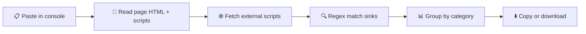

<div align="center">

# 🕳️ DOM Sink Scanner

**Find every dangerous DOM sink on a page, in one paste.**
A single-file, zero-install console script for bug bounty hunters and pentesters.


<br>

<!-- Replace with a screenshot of the tool -->


[How it works](#-how-it-works) · [Features](#-features) · [Usage](#-usage) · [Sink categories](#-sink-categories) · [Parameters](#-parameters) · [Limitations](#-limitations) · [Responsible use](#%EF%B8%8F-responsible-use)

</div>

---

## 💡 What is it?

Finding every risky DOM sink on a page by hand means re-reading the same `eval`/`innerHTML`/`postMessage` patterns over and over across dozens of scripts. **DOM Sink Scanner** does that scan for you.

Paste one script into the browser console and it statically scans the page's full HTML, every inline `<script>`, and every external script file for known dangerous DOM sinks — the kind of spot where untrusted data turns into XSS, prototype pollution, or an open redirect.

It only reads and matches text. It never executes, hooks or traces anything at runtime, and it only looks for sinks — it doesn't track sources.

## ⚙️ How it works



## ✨ Features

| | |
|---|---|
| 🔍 **8 sink categories** | HTML execution, JS execution, navigation/URL, attributes, jQuery, frameworks, network/storage, prototype pollution. |
| 🎚️ **Strict / full modes** | Strict keeps only high-signal sinks; full adds every pattern, including the noisy ones, for a complete audit. |
| 🧩 **Category filtering** | Scan everything, one category, or a chosen list — your call each time. |
| 🧹 **Deduplicated output** | The same match from the same source is only reported once. |
| 📊 **Grouped console output** | Results print as collapsible, sortable tables per category. |
| 📋 **One-command copy** | Pull the raw findings straight into your clipboard. |
| ⬇️ **JSON export** | Save a full scan as a timestamped JSON file. |
| 📦 **Zero dependencies** | Pure vanilla JavaScript. No install, no build step. |

---

## 🚀 Usage

1. Open the target page
2. Open DevTools (`F12`) and go to the **Console** tab
3. Paste the entire script and press **Enter** — nothing prints yet, it just defines the functions
4. Run a scan:

```javascript
sinkScan()                                           // strict mode, every category
sinkScan('full')                                     // full mode, every category
sinkScan('strict', 'jQuery')                         // strict mode, one category
sinkScan('full', ['HTML Execution', 'Framework'])    // full mode, a chosen list
```

5. Pull the results out:

```javascript
copy(window.__sinkFindings)   // copy to clipboard
downloadFindings()            // save as JSON
downloadFindings('scan.json') // save with a custom name
```

> 💡 Results reflect the page's DOM and scripts at the moment you scan. After an SPA navigation or a reload, run `sinkScan()` again.

---

## 🗂️ Sink categories

### Execution

| Category | Covers |
|---|---|
| 🧨 HTML Execution | `innerHTML`, `outerHTML`, `insertAdjacentHTML`, `document.write`/`writeln`, `srcdoc`, `DOMParser`/`parseFromString`, `createContextualFragment`, `setHTMLUnsafe`/`parseHTMLUnsafe` |
| ⚙️ JS Execution | `eval()`, `setTimeout`/`setInterval` with a string, `setImmediate`, `execScript`, `script.src`/`.text`/`.textContent`/`.innerText`, dynamic `import()`, `new Worker()`, `importScripts()` |

### Navigation & attributes

| Category | Covers |
|---|---|
| 🧭 Navigation / URL | `location`/`location.href`, `location.assign`/`replace`, writes to `location.search`/`.hash`, `window.open`, `a.href`, `form.action`/`formaction`, `iframe.src`, `embed.src`, `object.data`, `link.href`, `base.href`, meta refresh, `document.domain` |
| 🏷️ Attribute | `setAttribute` on sensitive attributes (`href`, `src`, `srcdoc`, `action`, `formaction`, `style`, `on*`) in strict mode, any attribute in full mode; `setAttributeNS`, `.attributes[]`; `style.cssText` in full mode |

### Libraries & frameworks

| Category | Covers |
|---|---|
| 💠 jQuery | `$()`/`jQuery()`, `.html()`, `.append`/`.prepend`/`.after`/`.before()`, `.replaceWith`/`.wrap*()`; in full mode also `.add()`, `.attr`/`.prop()`, `.load()`, `$.ajax`, `:contains()`; `$.parseHTML`, `$.globalEval`, `$.getScript` |
| ⚛️ Framework | `dangerouslySetInnerHTML` (React), `v-html` (Vue), `{@html}` (Svelte), `[innerHTML]` (Angular), `bypassSecurityTrust*` (Angular), `ng-bind-html`, `$sce.trustAs`, `$compile`; in full mode also `$eval`, `$watch`, `{{ }}` template injection |

### Data & integrity

| Category | Covers |
|---|---|
| 📡 Network / Storage | `postMessage`, `addEventListener('message')`, `XMLHttpRequest.open`, `fetch()`, `WebSocket`, `navigator.sendBeacon`; in full mode also `history.pushState`/`replaceState`, `document.cookie` writes, `localStorage`/`sessionStorage.setItem` |
| 🧬 Prototype Pollution | `Object.assign`, `merge`/`extend`/`deepMerge`/`defaultsDeep`, `__proto__`, `constructor.prototype`; in full mode also `JSON.parse` |

---

## 🎛️ Parameters

| Parameter | Type | Default | Description |
|---|---|---|---|
| `mode` | `'strict' \| 'full'` | `'strict'` | `strict` excludes high-noise, usually-low-risk patterns that flood results on normal pages; `full` includes everything, for a complete audit when you want zero false negatives even at the cost of noise. |
| `categories` | `string \| string[] \| null` | `null` (all categories) | Pass a single category name or an array of names to scan only those; leave empty to scan every category. |

---

## ⚠️ Limitations

- **Static, regex-based:** it reads source text, so it won't catch a sink built dynamically, like `window['inner'+'HTML']`.
- **CORS-blocked scripts are skipped:** external scripts without permissive CORS headers can't be fetched and read from the console.
- **Snapshot in time:** results reflect the DOM and scripts at scan time; re-run after any page change.

---

## ⚖️ Responsible use

This tool is for authorized security research and bug bounty work. Only scan targets that are **in scope** for a program you're participating in, or that you have permission to test.

## 📄 License

Released under the [MIT License](LICENSE).

<div align="center">
<sub>Built for hunters who read the DOM before they trust it. 🕳️</sub>
</div>
