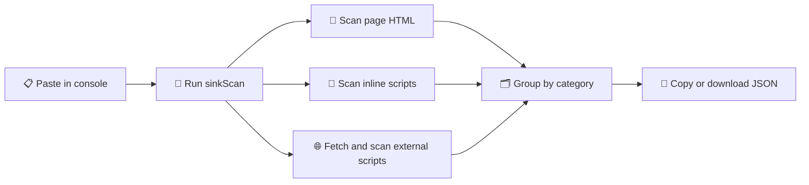

<div align="center">

# 🕳️ SinkScan

**Find DOM XSS sinks on any page, straight from the browser console.**
A single-file snippet for bug bounty hunters and pentesters.


<br>

<!-- Replace with a screenshot of the console output -->


[How it works](#-how-it-works) · [Features](#-features) · [Usage](#-usage) · [Sink categories](#%EF%B8%8F-sink-categories) · [Responsible use](#%EF%B8%8F-responsible-use)

</div>

---

## 💡 What is it?

Reading minified JavaScript to find dangerous sinks like `innerHTML`, `eval` or `postMessage` takes a long time. **SinkScan** searches for them for you.

Paste it into the DevTools console on any page. It scans the page HTML, every inline script and every external script, then groups the matches by category and prints them as tables.

It matches text patterns only. It doesn't prove that a sink is reachable or exploitable, so treat each hit as a lead to check by hand.

## ⚙️ How it works



## ✨ Features

| | |
|---|---|
| 🗂️ **8 sink categories** | HTML execution, JS execution, navigation and URL, attributes, jQuery, frameworks, network and storage, prototype pollution. |
| 📄 **Full page coverage** | Scans the page HTML, inline scripts and external scripts in one run. |
| 🎯 **Category filter** | Pass one category or a list to scan only what you need. |
| 🔍 **Context snippets** | Each hit shows the match, its source, and about 40 characters of code on each side. |
| 🧹 **Deduplicated results** | The same match in the same source is reported once. |
| 📊 **Readable output** | Findings print as collapsible console groups with a table per category. |
| 💾 **Easy export** | Copy the results to the clipboard or download them as a JSON file. |
| 📦 **Zero dependencies** | One snippet. No install, no build step, no extension. |

---

## 🚀 Usage

1. Open the target page and open DevTools (**Console** tab)
2. Paste the script and press Enter
3. Run a scan:

```js
// Scan all categories
await sinkScan();

// Scan one category
await sinkScan('jQuery');

// Scan several categories
await sinkScan(['HTML Execution', 'JS Execution']);
```

4. Export the results:

```js
// Copy to clipboard
copy(window.__sinkFindings);

// Download as JSON
downloadFindings();                 // sink-scan-<hostname>-<timestamp>.json
downloadFindings('my-results.json') // custom file name
```

> 💡 Results from the last scan are stored in `window.__sinkFindings`.

> 💡 External scripts are fetched from the page. If a script blocks the request (CORS) or the network fails, it is skipped without an error, so its sinks won't appear in the results.

> 💡 If you pass an unknown category name, SinkScan prints a warning with the valid names.

---

## 🗂️ Sink categories

| Category | What it looks for | Example patterns |
|---|---|---|
| 🧱 HTML Execution | HTML injection and parsing | `.innerHTML`, `document.write(`, `.srcdoc` |
| ⚡ JS Execution | Code execution and script loading | `eval(`, `setTimeout("...`, `new Worker(` |
| 🧭 Navigation / URL | Redirects and URL assignments | `location.href =`, `window.open(`, `iframe.src =` |
| 🏷️ Attribute | Attribute and inline handler writes | `.setAttribute(`, `onclick =`, `.style.cssText =` |
| 💲 jQuery | jQuery DOM and loading methods | `.html(`, `.append(`, `$.globalEval` |
| 🧩 Framework | Framework HTML and trust bypasses | `dangerouslySetInnerHTML`, `v-html`, `$sce.trustAs` |
| 🌐 Network / Storage | Messaging, requests and storage | `postMessage(`, `fetch(`, `document.cookie =` |
| 🧬 Prototype Pollution | Merge helpers and prototype access | `Object.assign(`, `__proto__`, `JSON.parse(` |

---

## ⚖️ Responsible use

This tool is for authorized security research and bug bounty work. Only scan targets that are **in scope** for a program you're participating in, or that you have permission to test.

<div align="center">
<sub>Built for hunters who read the sinks before they read the docs. 🕳️</sub>
</div>
